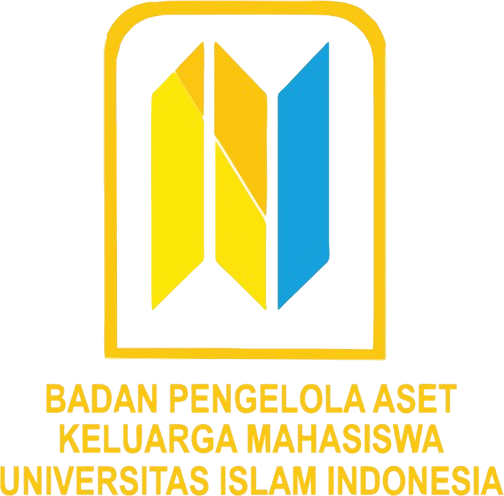
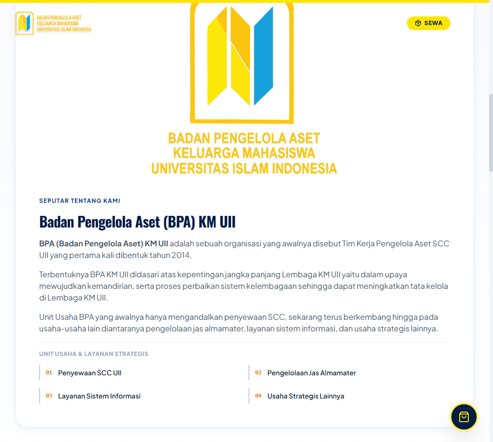
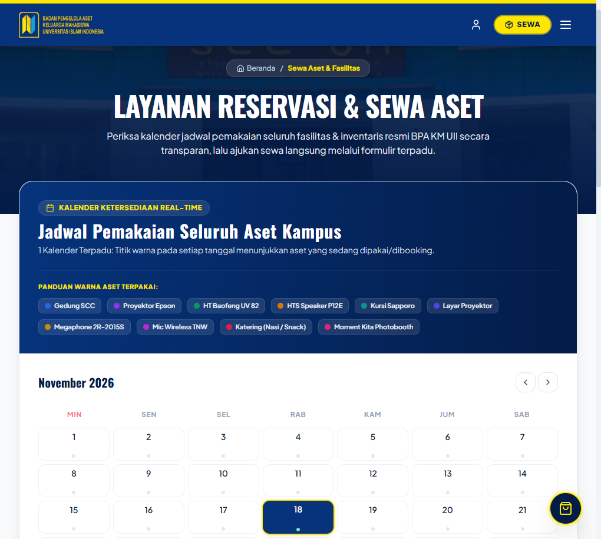
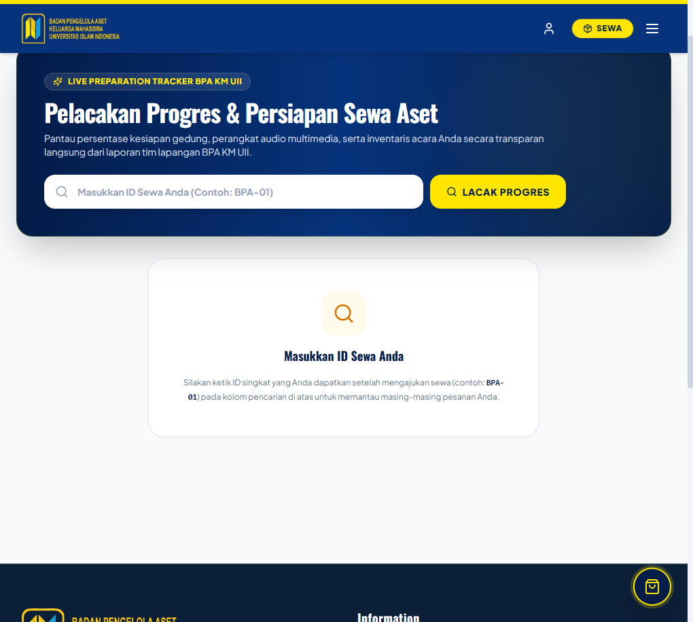
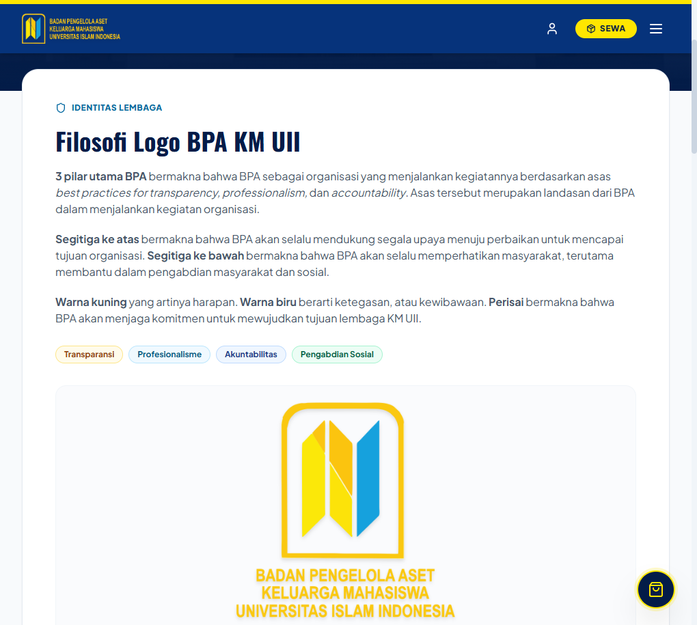

  

  # Portal Layanan & Manajemen Aset BPA KM UII

  **Platform Digital Resmi Badan Pengelola Aset Keluarga Mahasiswa Universitas Islam Indonesia (BPA KM UII)**

  
  
  
  
  

---

## Tentang Platform

**Portal BPA KM UII** adalah sistem informasi terpadu untuk pengelolaan aset, reservasi sarana dan prasarana (sarpras), pelacakan kesiapan lapangan secara transparan, serta publikasi informasi kelembagaan **Badan Pengelola Aset Keluarga Mahasiswa Universitas Islam Indonesia**.

Platform ini menghubungkan penyewa (mahasiswa, lembaga, maupun umum), tim operasional lapangan (PIC), dan pengurus inti dalam satu ekosistem digital yang modern, responsif, dan terintegrasi.

---

## Fitur Utama

### 1. Layanan Publik & Katalog Sewa Aset
- **Kalender Ketersediaan Real-Time**: Kalender terpadu lintas aset dengan penanda warna untuk melihat jadwal pemakaian gedung, sound system, proyektor, HT, kursi, dan perlengkapan acara lainnya.
- **Katalog Produk & Layanan**: Penjelajahan unit sarpras lengkap dengan kategori, stok tersedia, tarif sewa harian, dan keranjang reservasi.
- **Profil Lembaga, Investor, Galeri & Artikel**: Penyajian informasi unit usaha BPA KM UII, struktur pengurus, dokumen transparansi/LPJ, galeri dokumentasi foto & video, serta berita kegiatan.

### 2. Pelacakan Progres Sewa Transparan (Live Preparation Tracker)
- **Pencarian Kode Sewa**: Pemantauan status pemesanan menggunakan kode booking unik.
- **Indikator Kesiapan 6 Tahap**: Visualisasi progres terstruktur mulai dari **1. Pengajuan**, **2. Approval**, **3. DP**, **4. Cek Fisik**, **5. Setting**, hingga **6. Ready** dengan bar progres yang selaras dengan posisi tahapan aktif.
- **Berita Acara & Dokumentasi Lapangan**: Log pembaruan langsung dari tim teknis/PIC BPA lengkap dengan foto dokumentasi lapangan dan kontak WhatsApp PIC penanggung jawab.

### 3. Akun Pengguna & Riwayat Reservasi
- **Autentikasi Google OAuth & Akun Terdaftar**: Pengelolaan profil penyewa beserta riwayat pengajuan sewa yang tersinkronisasi.
- **Akses Cepat Detail & Tracking**: Pemantauan status persetujuan hingga penyelesaian acara dari halaman profil.

### 4. Portal Staf & Dashboard Admin Terpadu
- **Cek Pesanan Aset & Klaim PIC**: Penentuan penanggung jawab (PIC) aset, persetujuan cepat (Approve/Reject), dan pemantauan jadwal bentrok.
- **Approval & Laporan Penyewaan**: Pembaruan progres kesiapan dengan slider snap per tahap (Tahap 1–6), pengisian berita acara, serta unggah foto dokumentasi lapangan yang terkompresi otomatis.
- **Laporan Pendapatan Aset**: Rekapitulasi pemasukan dari seluruh transaksi penyewaan sarpras.
- **Website CMS Dinamis**: Pengelolaan konten Banner, Katalog Produk, Artikel/Berita, Pengurus/Investor, Dokumen LPJ, dan Galeri Dokumentasi dengan unggah foto langsung dari perangkat.

---

## Showcase Tampilan Website

| Profil & Unit Usaha BPA KM UII | Layanan Reservasi & Kalender Aset |
| :---: | :---: |
|  |  |

| Pelacakan Progres & Persiapan Sewa | Identitas & Filosofi Logo BPA KM UII |
| :---: | :---: |
|  |  |

---

## Arsitektur & Teknologi

| Komponen | Teknologi |
| :--- | :--- |
| **Frontend Framework** | React 18, Vite 6 |
| **Styling & Animasi** | Tailwind CSS 3, Framer Motion, Lucide Icons |
| **Backend & API** | Node.js, Express |
| **Database** | PostgreSQL (Neon Serverless) |
| **Autentikasi** | Google OAuth 2.0 & Role-Based Access (User, Staf, Admin) |

---

  © Badan Pengelola Aset Keluarga Mahasiswa Universitas Islam Indonesia (BPA KM UII)

